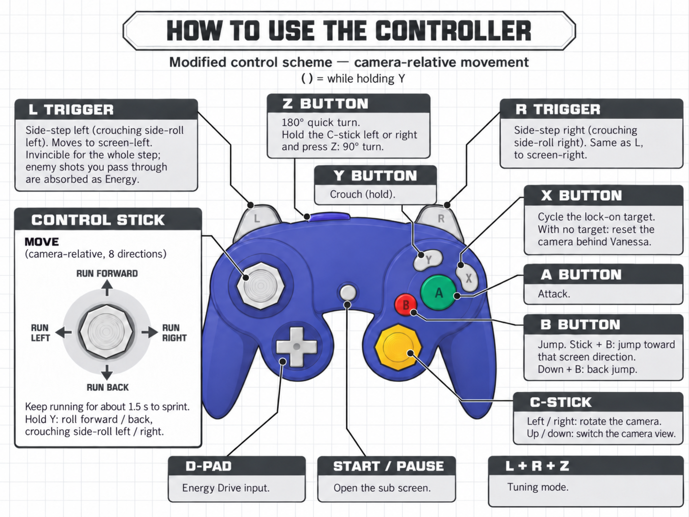

# P.N.03 Movement Plus

**P.N.03 Movement Plus** is a set of patches for the GameCube game P.N.03 (Japanese release GPNJ08 and North American release GPNE08). The patches change how Vanessa is controlled — camera-relative movement with a free camera — make side-steps invincible and turn them into a way to recover Energy, add a sprint, and fix a few things that got in the way. Enemies, damage, stages, bosses and scoring are untouched. The project was developed under the working name P.N.04.

The patches run as Dolphin per-game patches (no game files are modified) or as a patched `main.dol` applied with xdelta. The HD texture pack is a separate download.

*Version 0.1, 2026-10-08.*

Package layout: `dolphin/` (one patch file per region for Dolphin), `xdelta/` (binary patches for the disc images), `images/` (controller guide), `source/` (the source package of every patch: build script, tests, per-patch files), `INSTALL.md`, `TUNING.md`, `CREDITS.md`, `CHANGELOG.md`, `LICENSE`.

## Changes from the original

**Movement and camera**

1. **Camera-relative movement.** Push the control stick and Vanessa runs in that direction relative to the camera, in 8 directions. The original tank controls (up / down to run forward and back, left / right to turn on the spot) are gone.
2. **Free camera on the C-stick.** Left / right rotates the camera (sensitivity adjustable in the tuning mode); up / down keeps the original view switch. The camera settles behind Vanessa after quick turns and camera resets.
3. **Screen-relative jumps and side-steps.** Stick + B jumps toward that screen direction (press B right after pushing the stick; down + B is a back jump; B while already running is a forward jump). L / R always side-step to screen-left / screen-right, also while shooting or in the middle of a step chain.
4. **Quick turns.** Z still turns 180°. Hold the C-stick left or right and press Z for a 90° turn (originally control stick + Z). The camera comes around behind her new facing at her own turning pace; if she was facing the camera, the camera simply stays where it is.
5. **Crouch controls.** While holding Y, the control stick rolls forward / back or side-rolls left / right relative to the camera. A diagonal push picks the nearest of the four.
6. **Camera reset on X.** X with no lock-on target swings the camera back behind Vanessa (a half turn takes about 0.4 s); with a target it cycles targets as before and the camera turns toward the new one.

**Dodging and attacking**

7. **Invincible side-steps that absorb shots.** The whole side-step is invincible (the original protects only its first few frames), and every enemy shot you pass through during the step is absorbed: **+100 Energy** per shot, with the Energy-orb pickup flash and sound. Dodging into fire is now a way to refuel Energy Drives instead of something to avoid.
8. **Sprint.** Keep running for about 1.5 seconds and Vanessa speeds up; the trails on her hands and feet turn orange while sprinting. A sharp turn cancels it.
9. **Energy Drive shots pass through terrain.** ED projectiles are no longer swallowed by walls and floors, so a locked-on target in a corridor actually gets hit. (Some shots that miss may loop around before returning — known quirk.)
10. **Faster normal shots.** Vanessa's standard shot travels 2.5× faster (1,800 → 4,500 units per frame). Enemy shots and the Energy Drives are unchanged.
11. **Lead aim.** While locked on, normal shots are aimed at where the target will be when the shot arrives, using the measured shot speed.

**Other**

12. **Room-transition glitch fix (Dolphin only).** The giant triangles that could flash between the Mission 9 fights are gone; the screen stays dark as on real hardware.
13. **Tuning mode.** Hold L + R and press Z to open an on-screen tuning mode (camera sensitivity, jump timing window). Same combination to leave. Details: [TUNING.md](TUNING.md).

## Not changed

Enemies and bosses, damage taken and dealt, HP and Energy values (apart from the absorb), suits and upgrades, stage layouts and items, Energy Drive commands (D-pad), scoring and ranks, music, cutscenes.

## Known limitations

- Side-steps use the L / R click as in the original (no analog trigger threshold).
- Savestates made without the mod, or with an older version of it, carry the old code with them. After installing or updating, continue from a memory-card save.
- The camera swing of item 6 is new (the game's own camera smoothing arced over Vanessa's head when the camera started almost opposite to her) and is on the slow side; still being tuned.
- The quick-turn camera of item 4 (aimed at her final facing, paced to her own turning) was play-tested on 2026-10-08.
- The patched-ISO builds (xdelta, rebuilt 2026-10-08 with the current patch set) boot in Dolphin, but the stages have not been played through from them; the Dolphin patch files are the play-tested path.
- Compatibility with 60 fps hacks is unknown.
- Side-steps started while facing straight sideways (±90° to the camera) pick the nearer screen direction; this edge is rare but exists.

## Controls

## Installation

See [INSTALL.md](INSTALL.md): Dolphin patch files for GPNJ08 / GPNE08 (recommended, features can be switched individually), or the xdelta patches for the disc images.

## Tuning

See [TUNING.md](TUNING.md): the in-game tuning menu (camera sensitivity, jump window) and the lines to edit for other defaults.

## HD texture pack

Separate download: textures extracted from the game discs and upscaled 4×, for both regions (`GPN` folder): [https://archive.org/details/pn03-hd-texture-pack](https://archive.org/details/pn03-hd-texture-pack) (one zip, 1.41 GiB). Installation in [INSTALL.md](INSTALL.md).

## Credits

See [CREDITS.md](CREDITS.md).
